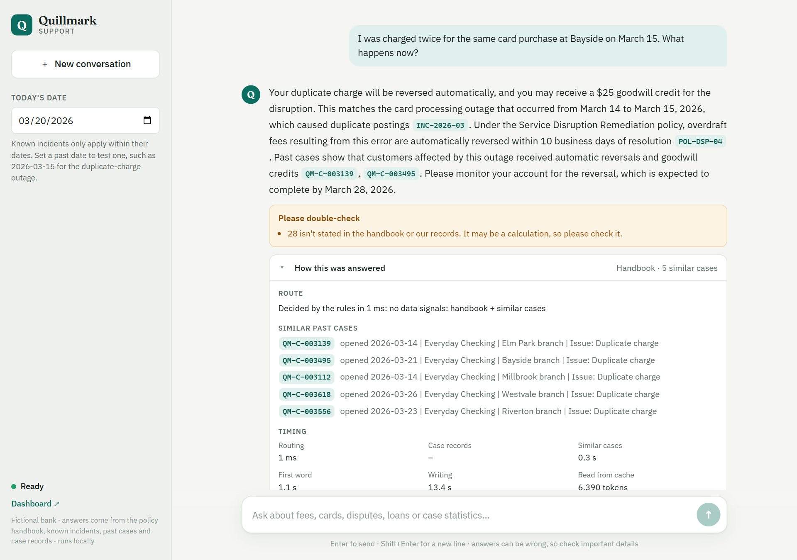
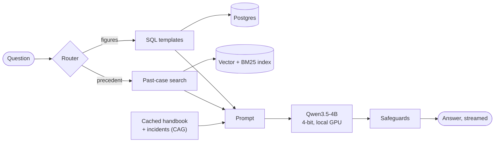
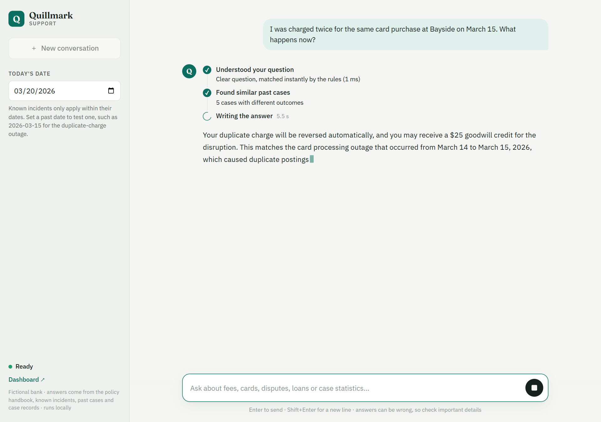

# Quillmark Support Chatbot

A customer-support chatbot for **Quillmark Bank**, a fictional bank, that runs entirely on one laptop GPU. It answers from the bank's policy handbook, known service incidents, 5,000 past support cases and a case database. It combines **CAG**, **RAG** and **SQL**, chooses between them per question with a **router**, and checks every answer with code-based **safeguards**.



## Highlights

- **Three knowledge sources, each used for what it's good at**
  - **CAG:** the whole handbook and incidents are cached in the prompt, so the first word arrives in about 1 to 2 seconds.
  - **RAG:** hybrid search (vectors + BM25 → rerank) finds 5 similar past cases, one per scenario.
  - **SQL:** counts and totals come from Postgres through whitelisted, parameterised, read-only queries.
- **Router:** rules decide clear questions in about 1 ms. The LLM fills a validated JSON form only when the rules can't tell.
- **Safeguards:** flags figures the model wasn't given, figures from other customers' cases, and citations of documents it didn't see. Other customers' amounts are masked before the model ever reads them.
- **Responsive web UI:**
  - a live progress checklist while the model works
  - smooth streaming text and a Stop button
  - clickable citations
  - a "How this was answered" panel showing the route, SQL and cases used
- **Monitoring:** every answer, its timings, flags and 👍/👎 feedback are logged to Postgres and shown on a Grafana dashboard.
- **Evaluation:** a 50-question test set plus 12 fresh questions, scored automatically, and 98 unit tests.
- **Fully local:** Qwen3.5-4B in 4-bit on an 8 GB GPU. No API keys and no data leaves the machine.

## How it works



1. The **router** reads the question. "How many fraud cases were opened in 2025?" goes to **SQL**. "I was charged twice, what happens now?" goes to **similar past cases**. The handbook is always available.
2. The fetched figures or cases are added to a copy of the **cached handbook prompt**, so only the new part has to be read.
3. **Qwen3.5-4B** writes the answer with citations such as `[POL-DSP-04]`, `[INC-2026-03]` or `[case records]`, streamed token by token.
4. **Safeguards** check the figures and citations, and the result is logged for the dashboard.

The full design, with diagrams, the event stream and the reasoning behind each choice, is in **[docs/architecture.md](docs/architecture.md)**.



## Results

Measured with `eval/run_eval.py` on the real model:

| Check | Result |
|---|---|
| Main question set (policy, data, incidents, follow-ups, off-topic …) | **48 / 50** |
| Fresh questions written after tuning | **11 / 12** |
| Correct route (rules + LLM) | **50 / 50** |
| Other customers' amounts leaked into answers | **0** |

| Speed (RTX 5050 laptop, 8 GB) | |
|---|---|
| Routing by rules / by the LLM | ~1 ms / ~4 to 5 s |
| Database query | ~50 ms |
| Past-case search + rerank | ~0.3 to 2 s |
| First word | ~1 to 2.5 s |
| Writing | ~2.4 tokens/s (see [Roadmap](#roadmap)) |

## Requirements

- An **NVIDIA GPU with 8 GB** or more, and a recent driver. Developed on an RTX 5050 Laptop GPU under Windows 11.
- **Python 3.11+** (developed on 3.12).
- **Node.js 18+** to build the web UI (developed on 24).
- **Docker** for Postgres and Grafana.
- About **15 GB of free disk** for the one-time model download and its 4-bit copy.

## Setup

```bash
# 1. Python environment
python -m venv .venv
source .venv/bin/activate          # Windows: .venv\Scripts\activate

# 2. PyTorch with CUDA first (pick the index URL for your CUDA version at pytorch.org), then the project
pip install torch --index-url https://download.pytorch.org/whl/cu128
pip install -e .

# 3. Settings (defaults work as they are)
cp .env.example .env

# 4. Postgres and Grafana
docker compose up -d

# 5. Build the data stores
python -m quillmark_bot.data.build_db     # case database from cases.jsonl + the handbook
python -m quillmark_bot.monitoring        # monitoring tables + Grafana's read-only login
python -m quillmark_bot.rag.index         # vector index of cases, policies and incidents

# 6. One-time: download Qwen3.5-4B, quantise it to 4-bit and save a local copy (~3 GB)
python -m quillmark_bot.model

# 7. Build the web UI
cd web && npm install && npm run build && cd ..
```

## Run

```bash
python -m quillmark_bot.server
```

Open **http://localhost:8000**. The model loads in the background when the server starts, which takes a minute or two. The page shows "Loading…" until it's ready.

| What | Where |
|---|---|
| Chat UI | http://localhost:8000 |
| Grafana dashboard | http://localhost:3000 (view without login; admin / `GRAFANA_ADMIN_PASSWORD` to edit) |
| UI with hot reload (development) | `cd web && npm run dev` → http://localhost:5173 (proxies `/api` to port 8000) |
| Chat in the terminal | `python -m quillmark_bot.hybrid` or `python -m quillmark_bot.hybrid -q "What is the overdraft fee?"` |

**Things to try**

- *What is the overdraft fee and how can I avoid it?* (policy)
- *How many duplicate charge complaints came from Bayside in 2026?*, then *And from Riverton?* (database + follow-up)
- Set **Today's date** in the sidebar to 2026-03-20, then ask *I was charged twice at Bayside on March 15. What happens now?* (a known incident)
- *Which branch had the most fraud complaints last year?* (database, grouped)

## Evaluate and test

```bash
python -m pytest                                             # 98 unit tests, no GPU needed
python eval/run_eval.py                                      # 50-question set on the real model (GPU)
python eval/run_eval.py --questions eval/questions_fresh.jsonl
python eval/run_eval.py --rescore eval/results/<run>.jsonl   # re-score saved answers, no GPU
```

Evaluation results are saved to `eval/results/` and appear on the Grafana dashboard. Only one copy of the model fits on an 8 GB GPU, so stop the server before running an evaluation.

## Configuration

Set in `.env` (see `.env.example`):

| Variable | Default | Purpose |
|---|---|---|
| `POSTGRES_USER` / `POSTGRES_PASSWORD` / `POSTGRES_DB` | `quillmark` | Database login |
| `POSTGRES_HOST` / `POSTGRES_PORT` | `localhost` / `5434` | Database address (5434 avoids clashing with a local Postgres) |
| `GRAFANA_PORT` / `GRAFANA_ADMIN_PASSWORD` | `3000` / `admin` | Dashboard |
| `GRAFANA_DB_PASSWORD` | `grafana_reader` | Grafana's read-only database login |
| `MODEL_ID` | `Qwen/Qwen3.5-4B` | Language model |
| `EMBED_MODEL_ID` / `RERANK_MODEL_ID` | `BAAI/bge-base-en-v1.5` / `BAAI/bge-reranker-base` | Retrieval models |
| `PORT` | `8000` | Web server port |

## Project layout

```
├── src/quillmark_bot/
│   ├── server.py            web API (FastAPI, server-sent events) + serves the UI
│   ├── hybrid/              the chatbot: router → SQL / past cases → cached-handbook answer → checks
│   ├── router/              rules, vocabulary and the LLM decision form
│   ├── cag/                 cached handbook + incidents prompt
│   ├── rag/                 documents, vector index, hybrid retriever
│   ├── analytics.py         whitelisted SQL templates
│   ├── checks.py            answer safeguards and amount masking
│   ├── generation.py        chunked prompt reading, streaming, stop
│   ├── model.py             4-bit model loading and the one-time quantised copy
│   ├── monitoring.py        usage, feedback and evaluation logging
│   └── data/                loading the source data, building the database
├── web/                     React + TypeScript UI (Vite)
├── eval/                    question sets, runner and scoring
├── tests/                   unit tests
├── db/                      SQL schemas (cases, monitoring)
├── monitoring/grafana/      dashboard and data source, provisioned as code
├── notebooks/01_eda.ipynb   exploration of the case data
├── docs/                    architecture and screenshots
├── policy_handbook.md       the bank's 32 policies
├── cases.jsonl              5,000 synthetic support cases
└── docker-compose.yml       Postgres + Grafana
```

## Troubleshooting

- **"The paging file is too small" (os error 1455) while loading the model:** Windows ran out of virtual memory, because GPU memory counts against it. Close other large programs, make sure `python -m quillmark_bot.model` has created the 4-bit copy, or enlarge the page file. Loading retries automatically a few times.
- **Out of GPU memory:** only one model copy fits on 8 GB. Make sure no other server or evaluation is running.
- **Figures say the database is unavailable:** start Docker and run `docker compose up -d`. The chatbot still answers from the handbook and past cases without it.

## Roadmap

- **Faster writing:** install the optimised kernels for Qwen3.5's linear attention (`causal_conv1d`, `flash-linear-attention`). Without them transformers uses a much slower fallback.
- **Decisions in code:** calculate fees such as "the lesser of $35 or 5%", and decide whether an incident applies, in code instead of the prompt. These cause the two remaining evaluation failures.

## Data

Quillmark Bank, its customers, cases, incidents and policies are **entirely fictional** and were generated for this project.
