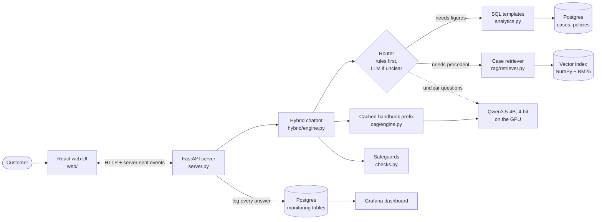
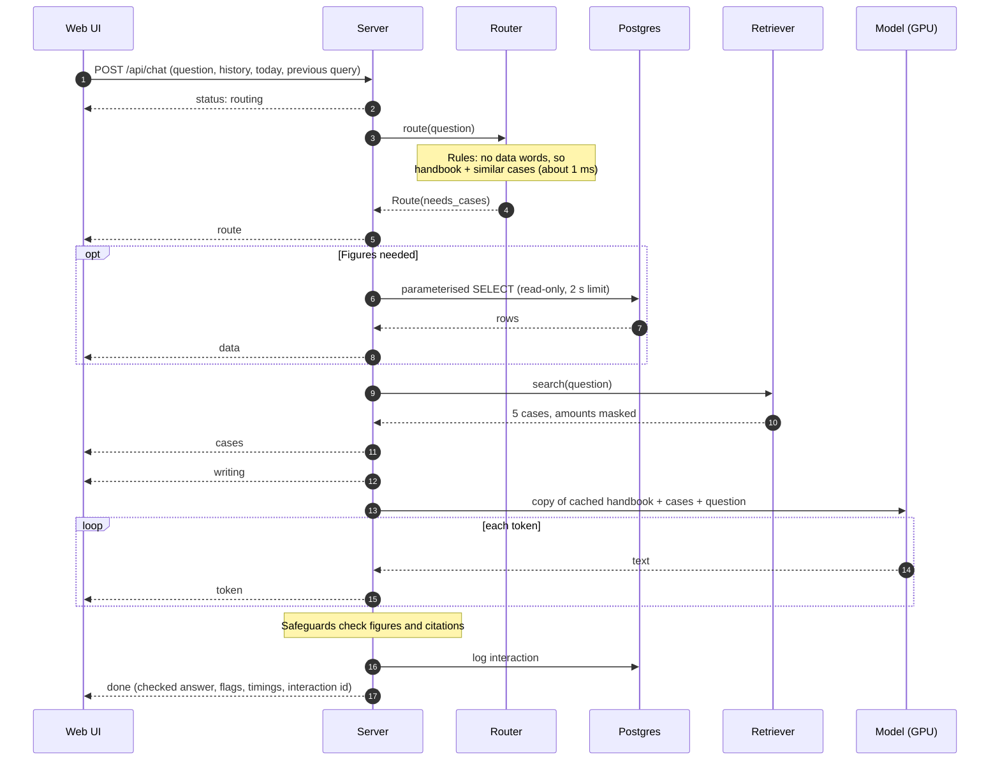
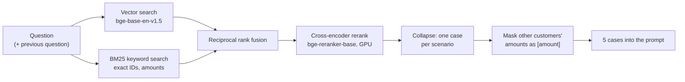

# System architecture

This document explains how the Quillmark support chatbot is put together: what each part does, how a question flows through the system, and why it was built this way. For setup and usage, see the [README](../README.md).

## Contents

1. [The big picture](#1-the-big-picture)
2. [The life of one question](#2-the-life-of-one-question)
3. [Data and storage](#3-data-and-storage)
4. [The language model](#4-the-language-model)
5. [CAG: the cached handbook](#5-cag-the-cached-handbook)
6. [The router](#6-the-router)
7. [SQL: figures from the case database](#7-sql-figures-from-the-case-database)
8. [RAG: similar past cases](#8-rag-similar-past-cases)
9. [Writing the answer](#9-writing-the-answer)
10. [Safeguards](#10-safeguards)
11. [Web server and streaming](#11-web-server-and-streaming)
12. [Web UI](#12-web-ui)
13. [Monitoring](#13-monitoring)
14. [Evaluation](#14-evaluation)
15. [Design principles](#15-design-principles)
16. [Hardware limits and performance](#16-hardware-limits-and-performance)
17. [Known limitations](#17-known-limitations)

---

## 1. The big picture

The chatbot answers customer questions for **Quillmark Bank**, a fictional bank. It draws on three kinds of knowledge, each handled by the technique that suits it best:

| Knowledge | Size | Technique | Why |
|---|---|---|---|
| Policy handbook (32 policies) and known incidents (5) | about 6,400 tokens | **CAG**: always in the prompt, read once and cached | Small enough to include in full, and almost every answer needs it |
| Past support cases | 5,000 cases | **RAG**: find the 5 most similar per question | Far too large for the prompt; only a few are relevant |
| Counts, totals and averages across cases | 5,000 rows | **SQL**: fixed, parameterised queries | A language model can't count 5,000 cases; a database can |

A **router** decides per question which of RAG and SQL are needed (CAG is always on). Code-based **safeguards** then check the finished answer. Everything runs locally on one laptop GPU.



### Module map

```
src/quillmark_bot/
├── config.py          paths, model IDs, database URL (from .env)
├── model.py           loads Qwen3.5-4B in 4-bit; one-time quantise-and-save
├── generation.py      chunked prompt reading, streaming, stop support
├── answer.py          the Answer record (text, timings, token counts, flags)
├── cag/               cached-knowledge answering (the handbook prefix)
├── rag/               documents, vector index, hybrid retriever
├── router/            rules, vocabulary, LLM decision form
├── analytics.py       whitelisted SQL templates for figures
├── checks.py          safeguards on finished answers
├── hybrid/            the chatbot that combines everything (used by the UI)
├── monitoring.py      usage, feedback and evaluation logging
├── server.py          FastAPI app: streaming chat API + serves the UI
└── data/              loading cases and the handbook, building the database
```

---

## 2. The life of one question

Take the question *"I was charged twice at Bayside on March 15. What happens now?"*:



The progress events (`route`, `data`, `cases`, `writing`) arrive within about half a second. The UI turns them into a live checklist, so the user sees work happening while the model writes.

---

## 3. Data and storage

### Source data (in the repo)

- **`policy_handbook.md`**: 32 policies, each a `### [POL-XXX-NN]` block under a `##` area (fees, cards, disputes, loans, collections and so on).
- **`cases.jsonl`**: 5,000 synthetic support cases opened 2025-01-01 to 2026-09-30, across 8 branches, 8 products and 51 issue types. Each case has the customer's narrative, the agent's notes, the resolution, the refund amount, satisfaction, outcome, related policies and, for 1,170 cases, a known incident.
- **Known incidents** (`data/incidents.py`): 5 incidents such as a card-processing outage that posted duplicate charges. Their root causes appear only in agent notes, so they are summarised by hand from those notes (see `notebooks/01_eda.ipynb`).

### Derived stores (rebuilt from the source)

| Store | Built by | Contents |
|---|---|---|
| Postgres: `policies`, `incidents`, `cases`, `case_policies` | `python -m quillmark_bot.data.build_db` | The case database for SQL figures and case look-ups |
| Postgres: `interactions`, `eval_runs`, `eval_results` | `python -m quillmark_bot.monitoring` (also on server start) | Usage, feedback and evaluation history for Grafana |
| `data/index/*.npy` + `*.ids.json` | `python -m quillmark_bot.rag.index` | 5,037 normalised embeddings (cases + policies + incidents) |
| `data/models/qwen3.5-4b-nf4/` | `python -m quillmark_bot.model` | The model saved already quantised to 4-bit |

Postgres runs in Docker (`docker-compose.yml`, port 5434). The vector index is a plain NumPy array: 5,037 vectors fit in memory and are searched exactly with one matrix product, so there's no vector database to run.

---

## 4. The language model

- **Model:** Qwen3.5-4B (`Qwen/Qwen3.5-4B`), loaded in 4-bit NF4 with bitsandbytes on an 8 GB laptop GPU (RTX 5050).
- **One copy, two jobs:** the same loaded model writes the answers and fills the router's decision form for unclear questions.
- **Pre-quantised copy:** quantising on load first memory-maps the full ~9 GB bf16 checkpoint, which can exhaust Windows' virtual memory. `python -m quillmark_bot.model` quantises once and saves a ~3 GB local copy that loads directly. Loading retries automatically if Windows reports "paging file is too small" (os error 1455).
- **Chunked prompt reading:** reading a ~7,000-token prompt in one pass needs more than 8 GB of activations, so prompts are read in 1,024-token chunks (`generation.py`).

---

## 5. CAG: the cached handbook

**Cache-augmented generation** puts the whole knowledge base in the prompt and saves the model's internal state after reading it, so later questions don't pay to read it again.

The cached prefix (`cag/knowledge.py` + the rules in `hybrid/engine.py`) holds:

1. **Answer rules:** grounding, how to treat past cases and database results, when incidents apply, how to cite, and the answer style.
2. **Worked examples** of good answers.
3. **The full policy handbook**, verbatim.
4. **The 5 known incidents**, with who they apply to (products, branches, dates) and how they were resolved.

That's about 6,400 tokens, read **once** when the server starts. For each question:

- The cached state is **deep-copied**, and only the new part (history, fetched cases or figures, the question) is read, typically 500 to 1,000 tokens.
- A copy is needed because Qwen3.5 mixes full-attention layers (a KV cache that could be trimmed back) with **linear-attention layers** (a running state that can't be rolled back). Reusing the cache in place would leak one question into the next.

Effect: the first word arrives in about 1 to 2.5 seconds instead of re-reading 7,000 tokens every time.

---

## 6. The router

The router (`router/`) decides per question whether to fetch **past cases**, **database figures**, both or neither. The handbook is always in the prompt, so the router never has to choose it.

### Rules first (about 1 ms)

`router/rules.py` uses plain pattern matching with a vocabulary built from the data (`router/vocab.py`): the official branch, product and issue names plus curated everyday aliases ("charged twice" means *Duplicate charge*). It also reads dates ("last year", "in March", "2025").

The rules decide in this order:

1. **A case ID** (`QM-C-001234`): look that case up in the database.
2. **A data question:** it needs both a *data word* ("how many", "total", "average", "most") **and** *something counted across cases* ("complaints", "customers", "which branch"). A data word alone is usually a policy question: "how many days do I have to dispute?" is about the handbook, not the database. If everything needed for the query is recognised, the rules build the query themselves.
3. **Unclear wording, a personal part, vague dates or an unrecognised subject:** ask the LLM.
4. **A short follow-up** to a data answer ("and in Riverton?"): ask the LLM, passing the previous query so it can be adjusted.
5. **Default:** the handbook plus similar past cases.

### The LLM only when unclear (about 4 to 5 seconds)

`router/llm.py` gives the model a small **JSON form** to fill: needs data? which metric, filters, dates, grouping? needs cases? Its instructions, allowed values and examples never change, so that prompt is **cached once**, like the handbook.

The model only *writes the form*. Code validates every field against the allowed values, and anything invalid is dropped. If the form can't be read at all, the default route is used and marked `rules (llm failed)`.

Route decisions (who decided, the reason, the raw JSON) are shown in the UI's "How this was answered" panel and logged for Grafana.

---

## 7. SQL: figures from the case database

`analytics.py` turns a validated `DataRequest` into SQL:

- **Metrics:** count, total refunded, average refund, average days to close, average satisfaction, outcome breakdown.
- **Filters:** branch, product, category, issue, channel, outcome, incident (OR within a field, AND across fields), plus an opened-date range.
- **Grouping:** by any of those fields or by month, up to 15 groups.

Safety:

- **Only whitelisted** metric expressions, filter columns and groupings ever become SQL text.
- Filter values travel as **query parameters**, so nothing the model writes is executed.
- Queries run in a **read-only transaction** with a **2-second** statement timeout.

The result comes back as plain text with a **"Counted:"** line that states exactly what was counted. The rules tell the model to say so when that's broader or narrower than what the customer asked about.

---

## 8. RAG: similar past cases

`rag/retriever.py` finds precedent for the question:



- **Hybrid search:** vectors capture meaning ("charged twice" matches "duplicate charge"), and BM25 catches exact tokens such as `INC-2026-03` or `$29`. Reciprocal rank fusion merges the two rankings.
- **Rerank:** a cross-encoder re-scores the candidates by reading question and case together.
- **Collapse by scenario:** agent notes are fill-in-the-blank templates, so many cases tell the same story with different numbers. Cases are grouped by their template (notes with numbers masked), and only the best case per template is kept. Without this, the top 5 often told one story five times.
- **Amount masking** (`checks.mask_amounts`): any amount in a past case that the handbook doesn't state is that customer's own, so it becomes `[amount]` before the model sees it. This stopped the model presenting another customer's refund as the current customer's.

For a follow-up question, the previous question is searched together with the new one, so "what about the fee?" still finds relevant cases.

---

## 9. Writing the answer

`hybrid/engine.py` assembles the new part of the prompt:

```
<database_results> ... </database_results>   (if the router asked for figures)
<past_cases> ... </past_cases>               (if the router asked for cases)
Customer question: ...
```

It adds the last 3 exchanges of history and today's date (incidents only apply within their dates), then generates up to 512 tokens. Streaming goes through a `TextStreamer` subclass that records when the first token arrives and forwards text to a callback. A `StoppingCriteria` checks a stop flag after every token, which is how the UI's Stop button ends generation.

The model is asked to cite every fact: `[POL-DSP-01]`, `[INC-2026-03]`, `[QM-C-000123]`, or `[case records]` for database figures.

---

## 10. Safeguards

The prompt's rules aren't trusted on their own. `checks.py` inspects every finished answer:

| Check | What it catches | What happens |
|---|---|---|
| **Unverified figures** | A number found in nothing the model was given (handbook, incidents, cases, database results, the question) | Flagged to the user: it may be honest arithmetic, or invented |
| **Case-only figures** | A number found only in other customers' past cases | Flagged: it isn't this customer's amount |
| **Invalid citations** | An ID cited that wasn't in the prompt | Flagged |
| **Database tags** | Invented tags like `[DATABASE-001]` | Rewritten to `[case records]` |

Earlier answers in the history aren't trusted as a source for figures, because they could carry an earlier mistake forward. Flags appear under the answer as "Please double-check" and are counted on the Grafana dashboard.

---

## 11. Web server and streaming

`server.py` is a FastAPI app.

### Startup

- The model loads in a **background thread** as soon as the server starts. Until it's ready, `/api/health` reports `loading`, and the UI shows a banner and disables input.
- It ensures the monitoring tables exist (best effort: the chatbot works without Postgres, minus figures and logging).
- If `web/dist` exists, it serves the built React app at `/`.

### Endpoints

| Endpoint | Purpose |
|---|---|
| `GET /api/health` | `loading` / `ready` / `error`, the model name, whether logging works |
| `POST /api/chat` | Ask a question; the response is a stream of server-sent events |
| `POST /api/feedback` | 👍 / 👎 / clear for a logged answer |
| `GET /api/documents/{id}` | Full text of a policy, incident or case, for the citation drawer |

### Chat event stream

```
status    {"stage": "queued"}      only if another answer is being written (one GPU, one answer at a time)
status    {"stage": "routing"}
route     who decided, why, the raw LLM form, whether data/cases are needed
data      what was counted, the result text, the SQL and parameters, the rows
cases     the 5 cases: ID, score, title
writing   {}
token     a piece of answer text          (repeated)
done      checked answer text, citations, flags, the data request, timings, interaction id
error     a message                       (instead of done)
```

The model runs in a worker thread holding a lock, because only one answer fits on the GPU at a time. Events cross to the async response through an `asyncio.Queue`. **When the client disconnects** (Stop, closed tab), the response generator's `finally` sets the stop flag, and generation ends at the next token, freeing the GPU for the next question. Stopped answers aren't logged.

---

## 12. Web UI

`web/` is React 18 + TypeScript, built with Vite. The model writes about 2 to 3 words per second, so the UI is designed to make waiting feel shorter:

- **Live progress checklist:** "Understood your question" ✓ (with how it was routed), "Checked the case records" ✓ (with the actual figure, such as "222 cases"), "Found similar past cases" ✓, then "Writing the answer" with a running timer. All but the last arrive within half a second.
- **Skeleton shimmer** until the first word, then a **typewriter** that reveals text at an even pace (it catches up faster when far behind), with a blinking cursor. Reduced-motion settings show text immediately.
- **Stop button:** the send button becomes Stop while busy.
- **Clickable citations:** IDs in the answer open a side drawer with the full policy, incident or case.
- **"How this was answered"** panel: the route and reason, the router's JSON, the SQL and its result rows, the similar cases, and a timing breakdown.
- **Flags, feedback and copy:** safeguard warnings, 👍/👎 (sent to monitoring), copy, and "first word X s · done in Y s".
- **History rules:** only completed answers are sent back as history. A stopped or failed question is left out, so the model never sees two user turns in a row. The previous answer's database query is sent along for follow-ups.
- **Today's date** can be changed in the sidebar to test incidents within their date windows.
- Light and dark themes follow the system, and the layout collapses to a top bar on phones.

Components: `App.tsx` (state and streaming), `api.ts` (SSE parsing over `fetch`), and `components/` (`Steps`, `AnswerText`, `Details`, `AssistantMessage`, `CitationDrawer`, `Composer`, `Sidebar`, `EmptyState`).

---

## 13. Monitoring

`monitoring.py` writes to three Postgres tables (`db/monitoring.sql`):

- **`interactions`:** one row per answered question: source (`app` or `eval`), question, answer, route, who decided, data and cases used, timings, token counts, safeguard flags, errors and feedback.
- **`eval_runs`** and **`eval_results`:** every evaluation run and its per-question scores.

Logging is best effort: if Postgres is down, the chatbot keeps answering.

**Grafana** (Docker, port 3000) is provisioned as code from `monitoring/grafana/`, with no clicking needed. It reads through a `grafana_reader` login that can only `SELECT`. The dashboard has 15 panels: questions, median first-word and total time, answers flagged, failed questions, rated helpful, response time over time, sources used, who decided the route, safeguard flags, feedback, evaluation score and runs, questions failing in the latest evaluation, and recent questions.

---

## 14. Evaluation

`eval/run_eval.py` runs the real chatbot on a question set and scores it with `eval/scoring.py`:

- **`eval/questions.jsonl`:** 50 questions covering policy (17), rule-routed data (10), LLM-routed data (5), incidents that apply (5), incidents that don't (4), follow-ups (3), questions the handbook doesn't cover (3), off-topic (2) and a case look-up (1).
- **`eval/questions_fresh.jsonl`:** 12 questions written after tuning, to check the system wasn't just fitted to the first set.

Each item lists facts the answer **must** contain, facts it must **not** contain, and the expected **route**. Safeguard flags are counted separately. `--rescore` re-checks saved answers without the GPU. Results go to `eval/results/` and to the monitoring tables.

`tests/` holds 98 fast unit tests (no GPU): router rules and a route check over the evaluation questions, SQL building, safeguards, scoring, monitoring and the server's event stream (with a fake bot).

---

## 15. Design principles

**The model writes, code decides.** A 4B model writes fluent, well-grounded text but is unreliable at decisions. Almost every quality gain came from moving a decision out of the prompt and into code:

| Problem | Moved into code |
|---|---|
| Wrong figures from "counting" cases in the prompt | SQL templates |
| Inconsistent routing | Rules first; the LLM only fills a validated form |
| Model-written SQL is unsafe | Whitelisted templates + parameters + read-only |
| Other customers' amounts presented as the customer's | Masking before the model sees cases |
| Unbacked figures, invented citations | Safeguard checks after the answer |

**Use each technique for what it's good at.** CAG for small, always-needed knowledge; RAG for large, occasionally-relevant precedent; SQL for anything counted.

**Show the work.** Every answer can explain itself: the route and reason, the query, the cases used, the timings and the flags. That makes failures debuggable and builds user trust.

**Measure on fresh questions.** Changes are judged on the 12-question fresh set as well as the 50 the system was tuned on.

---

## 16. Hardware limits and performance

Target machine: Windows 11 laptop, RTX 5050 with 8 GB of GPU memory, 16 GB of RAM.

- **Only one model copy fits.** On Windows, GPU memory also counts against the virtual-memory commit limit. The server and an evaluation run can't both hold the model.
- **GPU memory** sits at about 7.4 of 8.1 GB while serving.

Measured on 2026-11-05:

| Stage | Time |
|---|---|
| Rule routing | about 1 ms |
| LLM routing (unclear questions) | about 4 to 5 s |
| SQL query | about 50 ms |
| Case retrieval + rerank | about 0.4 to 2 s |
| First word | about 1 to 2.5 s |
| Writing | about 2.4 tokens/s |

Writing is the bottleneck. The server log shows the optimised kernels for Qwen3.5's linear attention (`causal_conv1d`, `flash-linear-attention`) aren't installed, so transformers falls back to a slower PyTorch implementation. This is the first target for optimisation.

---

## 17. Known limitations

- **Writing speed** (above).
- **Two failing evaluation items** (48/50): the loan late fee "the lesser of $35 or 5%" is sometimes applied backwards, and one answer mentions an incident that doesn't apply. Both are decisions the model makes in the prompt today. Planned fix: calculate fees and decide incident applicability in code.
- **Single user at a time:** one GPU means answers are queued.
- **Synthetic data:** the bank, customers, cases and incidents are fictional.
